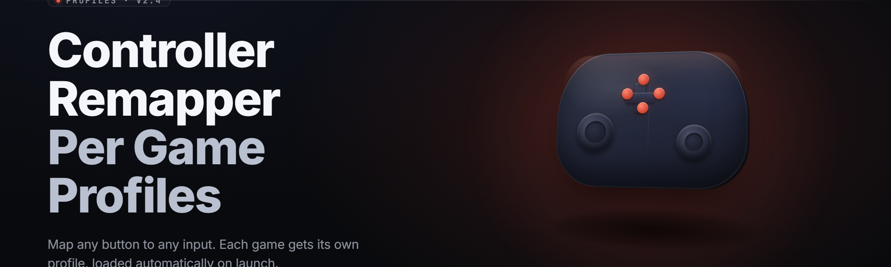

  
  
  

  

  
  
  

---

**Stop re-binding your controller every time you switch games.** Controller Remapper with Per-Game Profiles is a Windows .exe that watches which game is in focus, swaps the entire mapping set on the fly, and exposes raw gamepad, keyboard, mouse, and XInput macros behind one profile system — no drivers, no reboot, no launcher hooks.

Profiles are plain JSON, hot-reloadable, and per-executable. You map a game once, and every time that .exe takes focus, the tater flips the whole stack underneath it — deadzones, curves, gyro, turbo, and combo chains included.

---

## 📖 Overview

| Category | Details |
| --- | --- |
| **Product** | Controller Remapper with Per-Game Profiles |
| **Release** | v2.4.1 "Starch" (2026) |
| **Runtime** | Native Win32, single-process, no service |
| **Input backend** | Raw HID + XInput + DirectInput + DualSense/DualShock/DualShock 4/Switch Pro |
| **Profile format** | JSON v3 schema, hot-reload on save |
| **Focus engine** | Per-exe detection via ETW process events (<8ms swap) |
| **Distribution** | Portable `.exe`, extract-and-run |
| **License** | MIT |

Controller Remapper is built for the case where you have eleven games installed, three controllers on the desk, and zero patience for the in-game remap menu. It sits between the hardware and the OS, reads the raw device stream, applies your profile's transform pipeline, and re-emits a virtual gamepad. Games see a normal controller. You see a normal controller. The mapping just changes when it should.

The per-exe focus engine is the core of it: it listens for process-focus events, matches the foreground executable against your profile rules, and swaps the active binding set in under one frame. Alt-tab out, mapping reverts to your global profile. Launch a game, mapping snaps to that game's profile.

### 🔧 A word on "the virtual pad"

The remapper presents a single virtual XInput gamepad plus a keyboard/mouse shim. Games that read XInput see one controller. Games that read raw HID see the original device. The transform runs before either — so deadzone curves, gyro-to-stick, and turbo all apply uniformly.

---

## 📚 What is a "profile"? — glossary

| Term | Explanation |
| --- | --- |
| **Profile** | A JSON document binding one or more executables to a full input pipeline. |
| **Rule** | A single binding: input event → output event, with optional transform. |
| **Pipeline** | Ordered list of transforms (deadzone, curve, anti-deadzone, gyro) applied before output. |
| **Focus match** | The glob/regex used to bind a profile to a process name (e.g. `*eldenring*.exe`). |
| **Macro** | A timed sequence of synthetic key/button events triggered by one physical input. |
| **Layer** | A modifier set that overlays the base profile while held (e.g. "shift" layer). |
| **Shim** | The synthetic output device the remapper exposes to games. |

**Benefits at a glance:**
- One controller, infinite layouts — switch is automatic on focus.
- No driver install, no kernel component, no reboot.
- Plain-text profiles you can diff, version, and share.
- Hot-reload: edit JSON, save, done. No restart.
- Works alongside Steam Input without fighting it (opt-out per profile).

---

## ⚙️ System Requirements

| Component | Minimum | Recommended |
| --- | --- | --- |
| OS | Windows 10 21H2 (x64) | Windows 11 24H2 / SteamOS 3.6 (Proton) |
| CPU | Dual-core 2.0 GHz | Quad-core 3.0 GHz+ |
| RAM | 512 MB free | 1 GB free |
| Disk | 40 MB | 120 MB (profiles + logs) |
| Runtime | VC++ 2015–2022 redist | VC++ 2022 x64 latest |
| USB | Any HID-compliant gamepad | Wired DualSense / Xbox Series pad |
| Display | 1280×720 | 1920×1080+ |
| Permissions | Standard user | Admin (only for elevated games) |

---

## 🧩 Key Features

| Feature | Description | Benefit |
| --- | --- | --- |
| Per-exe focus swap | Matches foreground process against glob rules | Right layout, automatically |
| Raw HID capture | Reads device stream before OS remap | No double-input conflicts |
| Virtual XInput shim | Emits a clean synthetic gamepad | Games see one pad, always |
| Curve editor | 5-point response curves per axis | Precision aiming without in-game menus |
| Gyro → stick | IMU rate mapped to right stick | Motion aiming in any game |
| Turbo & autofire | Configurable per-button rate, duty cycle | Rapid-fire without mods |
| Combo macros | Timed key/button sequences | Fighting-game inputs, one button |
| Layers & modifiers | Hold-to-overlay mapping sets | Dozens of binds per button |
| Deadzone wizard | Auto-detect noisy sticks | Kills drift, keeps precision |
| Hot-reload | Profile re-parse on file save | Tune without restarting |
| Per-device profiles | Different layout per physical pad | Desk pad ≠ couch pad |
| Cloud-sync-ready | Profiles folder is portable | Sync with any file tool |

---

  

---

## 🔍 The Problem

- Every game hides its remap menu in a different submenu, and half of them cap you at 8 rebinds.
- Steam Input works until it doesn't — Proton quirks, per-launcher overrides, overlay fights.
- ReWASD/Karabiner-class tools charge per-seat and lock layouts behind a paywall.
- In-game deadzone sliders are coarse; you can't draw a real response curve.
- Alt-tabbing between a game and a desktop app should not nuke your binds.
- Motion aiming is game-specific and inconsistent across titles.
- Sharing a layout with a friend means screenshots of a settings page.

## 🎯 The Solution

| Problem | Solution |
| --- | --- |
| Hidden remap menus | One JSON profile per game, matched by exe |
| Steam Input fights | Opt-out per profile; remapper runs first |
| Paywalled tools | MIT license, portable `.exe`, no account |
| Coarse deadzones | 5-point per-axis response curves |
| Alt-tab nukes binds | Focus engine swaps back to global profile |
| Inconsistent gyro | Uniform gyro→stick pipeline across games |
| Sharing layouts | Plain-text profiles, diff-friendly, shareable |

---

## 🕹️ Grouped Module Catalog

Everything below ships in the base `.exe`. Status table at the end of this section.

### 🎮 Capture & Input Backend

The capture layer opens every gamepad the OS presents, reads raw HID reports, and normalizes them into a common event struct. It runs in a single thread per device with a lock-free ring buffer to the transform stage.

- **Raw HID reader** — bypasses OS remap, sees the true device stream.
- **XInput reader** — for XInput-only pads and Xbox wireless.
- **DualSense/DualShock reader** — native reports, including touchpad and IMU.
- **Switch Pro reader** — native parse, including NFC stub.
- **DirectInput reader** — legacy pads and racing wheels.

### 🧠 Transform Pipeline

Ordered transforms that sit between capture and output. Each stage is optional and configured per profile.

- **Deadzone** — radial or per-axis, with hysteresis.
- **Anti-deadzone** — expands small inputs for light-touch games.
- **Response curve** — 5-point spline per axis, editable in JSON.
- **Inversion & swap** — per-axis invert, X/Y swap.
- **Scaling** — per-axis multiplier, clamp.
- **Gyro → stick** — IMU rate mapped to right stick with smoothing.

### 🎛️ Bindings & Macros

- **Simple rebind** — button → button, button → key, button → mouse.
- **Turbo** — hold to autofire at configurable rate/duty.
- **Combo macro** — timed sequence with per-step hold/up.
- **Layers** — hold a modifier to overlay an alternate binding set.
- **Toggle layers** — tap to latch a layer until tapped again.
- **Chord bindings** — two buttons together trigger a macro.
- **Axis-to-button** — trigger threshold → button event.

### 🖥️ Focus Engine & Profiles

- **Per-exe matching** — glob and regex rules on process name.
- **Focus swap** — <8ms swap on foreground change (ETW-backed).
- **Window-title match** — optional secondary matcher for launchers.
- **Global fallback** — default profile when no rule matches.
- **Hot-reload** — file watcher re-parses on save.
- **Profile includes** — compose profiles from shared fragments.
- **Per-device override** — different layout per physical pad.

### 🧪 Diagnostics & Tools

- **Input monitor** — live event stream with latency counters.
- **Deadzone wizard** — captures drift, suggests values.
- **Curve preview** — plots the response curve.
- **Macro recorder** — record timing by hand, export JSON.
- **Profile validator** — schema check with line-level errors.
- **Log export** — anonymized capture dump for bug reports.

### 🔌 Compatibility & Interop

- **Steam Input opt-out** — per-profile suppression hint.
- **Steam Deck layout** — reads the Deck's built-in pad natively.
- **Discord input passthrough** — push-to-talk unaffected by remap.
- **Anti-cheat safety note** — pure userspace, no injection, no kernel.
- **Hotkey suppression** — swallow unbound system keys per profile.
- **Per-game admin elevation** — opt-in elevated helper.

### 📊 All Modules Status

| Module | Status | Description |
| --- | --- | --- |
| Raw HID reader | ✅ Working | True device stream, bypasses OS remap |
| XInput reader | ✅ Working | Xbox wired/wireless, standard reports |
| DualSense reader | ✅ Working | Native reports + touchpad + IMU |
| Switch Pro reader | ✅ Working | Native parse, NFC stub present |
| DirectInput reader | ✅ Working | Legacy pads, wheels, joysticks |
| Deadzone stage | ✅ Working | Radial + per-axis, hysteresis |
| Anti-deadzone stage | ✅ Working | Light-touch expansion |
| Curve stage | ✅ Working | 5-point spline per axis |
| Gyro → stick | ✅ Working | IMU rate → right stick, smoothed |
| Turbo | ✅ Working | Configurable rate + duty cycle |
| Combo macro | ✅ Working | Timed sequence, per-step hold/up |
| Layers (hold) | ✅ Working | Overlay on modifier hold |
| Layers (toggle) | ✅ Working | Latch until re-tap |
| Chord bindings | ✅ Working | Two-button combos |
| Axis-to-button | ✅ Working | Trigger threshold → button |
| Per-exe matching | ✅ Working | Glob + regex on process name |
| Focus swap | ✅ Working | ETW-backed, <8ms |
| Window-title match | ✅ Working | Secondary matcher |
| Global fallback | ✅ Working | Default profile |
| Hot-reload | ✅ Working | File watcher re-parse |
| Profile includes | ✅ Working | Fragment composition |
| Per-device override | ✅ Working | Layout per physical pad |
| Input monitor | ✅ Working | Live stream + latency |
| Deadzone wizard | ✅ Working | Drift capture, suggestion |
| Curve preview | ✅ Working | Response curve plot |
| Macro recorder | ✅ Working | Hand-record, JSON export |
| Profile validator | ✅ Working | Schema + line errors |
| Log export | ✅ Working | Anonymized dump |
| Steam Input opt-out | ✅ Working | Per-profile suppression hint |
| Steam Deck layout | ✅ Working | Native Deck pad parse |
| Discord passthrough | ✅ Working | PTT unaffected |
| Hotkey suppression | ✅ Working | Swallow unbound keys |

---

## 🚀 Quick Start

1. 🧲 **Download** the archive from the project page.
2. 📂 **Extract** to any folder — `C:\Tools\CtrlRemap\` works fine, no installer.
3. ▶️ **Run** the `.exe`. Windows SmartScreen may ask once; click "More info → Run anyway."
4. 🎮 **Plug in** a controller. The input monitor lights up with live events.
5. 📝 **Open** `profiles\global.json`, edit a binding, save. Watch it hot-reload.

---

## 🛠️ Installation

1. **Grab the release.** Go to the project page and pull the latest ZIP from the releases section. The archive contains the `.exe`, a `profiles\` folder, and a short `README.txt`.
2. **Extract anywhere.** Portable layout — the app writes nothing to `Program Files` and nothing to the registry unless you enable "autostart." Extract to a folder you own.
3. **Run the `.exe`.** First launch creates `%APPDATA%\CtrlRemap\` for logs and a per-user profile folder. The window opens on the Input Monitor tab with your connected pads listed.

That's it — no pip, no npm, no git clone, no service to register.

---

## 🧭 How To Use (overlaps with Installation but gets practical)

- **Bind a game.** With the game focused, click "Capture focus," name the profile, and it writes `eldenring.json` next to the global one.
- **Edit a binding.** Open the JSON, find the `"bindings"` block, change `"A"` to `"keyboard.space"`, save.
- **Add a layer.** Add a `"layers"` entry with `"modifier": "LB"` and an override map. Hold LB in-game to feel it.
- **Tune curves.** Open the Curve Preview tab, drag the 5 points, watch the plot, save to apply.
- **Compose profiles.** Use `"$include": ["common/gyro.json"]` to share a pipeline across games.

> Tip: keep `global.json` as a sane desktop layout; every game profile can `$include` it and only override what differs.

---

## 🖥️ Compatibility

| Platform | Status | Notes |
| --- | --- | --- |
| 🪟 Windows 11 | ✅ Tested | Primary target, 24H2 |
| 🪟 Windows 10 | ✅ Tested | 21H2+, x64 only |
| 🎮 Steam Deck (SteamOS 3.6) | ✅ Tested | Proton, use the Deck pad profile |
| 🟢 Steam Input | ✅ Coexists | Opt-out per profile |
| 💬 Discord | ✅ Unaffected | PTT passthrough verified |
| 🎧 OBS / streaming | ✅ Unaffected | No overlay capture change |
| 🏎️ Racing wheels (DirectInput) | ⚠️ Partial | Force feedback not remapped |
| 📱 Mobile pads (BT HID) | ✅ Tested | Standard HID gamepads only |

---

## 📊 Comparison

| Aspect | Alternative | This Tool |
| --- | --- | --- |
| Pricing | Per-seat license | MIT, free |
| Config format | Opaque binary | Plain JSON, diffable |
| Focus swap | Manual profile pick | Automatic per-exe |
| Gyro pipeline | Game-specific | Uniform across titles |
| Steam Input | Required or conflicting | Coexists, opt-out per profile |
| Sharing layouts | Screenshots | Text files |
| Hot-reload | Restart required | Save-to-apply |
| Kernel footprint | Sometimes | None — userspace only |

---

## 🧯 Troubleshooting Flow

1. **No input in the monitor?** Check the pad is HID-compliant and not already grabbed by another tool (Steam Input, DS4Windows).
2. **Game ignores the virtual pad?** Some titles read raw HID only — set `"shim": "hid"` in the profile.
3. **Focus swap laggy?** Confirm ETW isn't blocked by AV; whitelist the `.exe`.
4. **Binds fire twice?** Another tool is also remapping — disable one.
5. **Elevated games ignore the remapper?** Enable the per-game elevated helper in settings.

---

## 🩹 Known Issues

| Issue | Solution |
| --- | --- |
| SmartScreen warning on first run | Click "More info" → "Run anyway"; sign the binary yourself if you want it gone. |
| DualSense haptics not passed through | Haptics are not remapped in v2.4; audio-haptics passthrough is on the roadmap. |
| Steam Input re-grabs the pad | Set `"steam_input": "off"` per profile and restart Steam once. |
| Bluetooth pads drop on resume | Reconnect the pad; the focus engine re-attaches on next event. |
| Profile JSON fails to parse | Run the Profile Validator tab — it reports the line and column. |
| Focus engine misses launcher windows | Add a window-title match as a secondary rule in the profile. |

---

## 📥 Download again

  

---

## ❔ FAQ

<strong>Does this require a kernel driver?</strong>

No. The remapper is pure userspace — it reads HID/XInput and emits a virtual gamepad via the OS's own virtual device path. No .sys, no signed driver, no reboot.

<strong>Will this get me banned in online games?</strong>

The remapper does not inject, hook, or read game memory. It presents a normal controller. Whether a given anti-cheat treats external remappers as suspicious is a game-by-game question — check each title's terms.

<strong>Does it conflict with Steam Input?</strong>

Not by default. Steam Input can grab the pad first, so profiles expose a `"steam_input": "off"` hint and a per-profile opt-out. If both remap, disable one.

<strong>Can I use one profile for multiple games?</strong>

Yes — focus rules accept glob and regex, so `"*racing*.exe"` can bind a whole genre.

<strong>Where are profiles stored?</strong>

Next to the `.exe` in `profiles\`, plus a per-user folder at `%APPDATA%\CtrlRemap\profiles\`. The per-user folder wins on conflict.

**Q: Does it work on Steam Deck?**  
**A:** Yes, under SteamOS 3.6 with Proton. The Deck's built-in pad profile ships with the release; use the "Deck" layout preset.

**Q: Can I remap a keyboard to a controller?**  
**A:** Yes — bindings are bidirectional. Keyboard and mouse inputs can drive the virtual gamepad, and vice versa.

**Q: Is there a portable mode?**  
**A:** The `.exe` is portable by default. No registry writes unless you enable "autostart with Windows."

**Q: Will my profile survive an update?**  
**A:** Yes. Profiles are plain JSON and the schema is versioned (`"schema": "v3"`). The validator flags any field that changed between versions.

---

## 🧷 Usage Guidelines

| Allowed | Not allowed |
| --- | --- |
| Personal remapping of any game you own | Redistribution of the `.exe` under a different name |
| Sharing profiles you wrote | Bundling profiles you don't have rights to |
| Forking the MIT source | Removing the license header |
| Using with accessibility needs | Sublicensing as closed-source |
| Streaming/broadcasting while using | Claiming authorship of the upstream project |

---

## 🧠 Tips for Best Results

- Start from the shipped `global.json` and clone it per game — don't build from scratch.
- Use the Deadzone Wizard once per pad; drift profiles change over months.
- Keep `$include` fragments small (`gyro.json`, `deadzone.json`) and compose them.
- Bind a "panic" chord to `LoadProfile: global` — one button back to sanity.
- Watch the Input Monitor's latency counter; >2ms means a transform stage is heavy.
- For gyro aiming, set a low-pass on the IMU rate before mapping to stick.
- If a game reads raw HID, set `"shim": "hid"` and skip the XInput shim.
- Version your profiles in git — diffs catch accidental rebinds instantly.

---

## 🔚 Closing

Controller Remapper with Per-Game Profiles exists for the exact moment a game steals focus and your layout should have already changed. It's portable, userspace-only, and MIT-licensed, so it fits wherever you drop it. Map once, save, forget — the tater handles the swap while you're still in the menu. absolute potato to Sam — this one's shipping clean.
